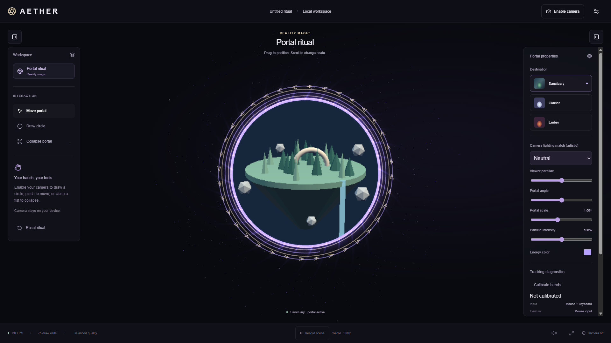

# AETHER

Reality is yours to rewrite.

An experimental, local-first browser studio for real-time portals. This repository currently implements the foundation and an initial Portal Ritual vertical slice. It is **not** the complete long-term AETHER product.



## Run locally

Node.js 22.19 or later is required.

```sh
npm ci
npm run dev
```

Open http://127.0.0.1:3000. Enter the studio without granting camera permission. Drag the portal to move it, scroll or use + / - to resize, and press Space to open or collapse it. The inspector changes the rendered destination, energy color and particles. Save/load stores a portal preset locally.

Camera access starts only when **Enable camera** is clicked. MediaPipe runtime/model downloads require internet. Draw a deliberate circle with your index finger to open the portal, pinch to move, show two open hands to scale, and close a fist to collapse. Tracking is experimental; hardware testing and calibration remain outstanding.

Record scene captures the rendered scene plus the camera when enabled, with an explicit start/stop action. Stop exports a local WebM file. Microphone and audio are not recorded. Nothing is uploaded.

## Commands

- `npm run typecheck` — strict TypeScript
- `npm run lint` — Next.js and TypeScript ESLint rules
- `npm test` — deterministic interaction tests
- `npm run test:e2e` — Playwright browser suite (starts the dev server automatically; install Chromium with `npx playwright install chromium`). `AETHER_BROWSER_PATH` can select an existing Chromium executable.
- `npm run build` — production static export in `out/`
- `npm run format` — Prettier

See [PROGRESS.md](PROGRESS.md), [TEST_REPORT.md](TEST_REPORT.md), and [ARCHITECTURE.md](ARCHITECTURE.md) for actual scope and verification. No AI provider, creature system or multiplayer service is implemented yet.

## Deploy

Run `npm run build` and serve the `out/` directory using any static HTTPS host. There are no server-side secrets or services in this increment. Camera access requires HTTPS except on localhost. Do not use `next start` with this static-export configuration.
